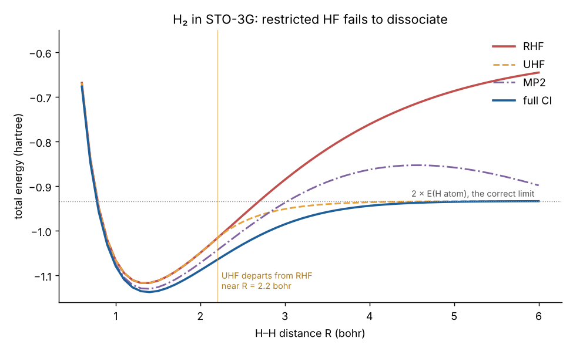
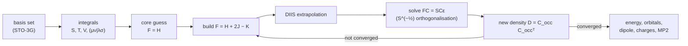
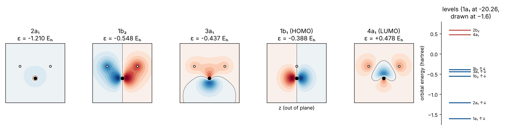
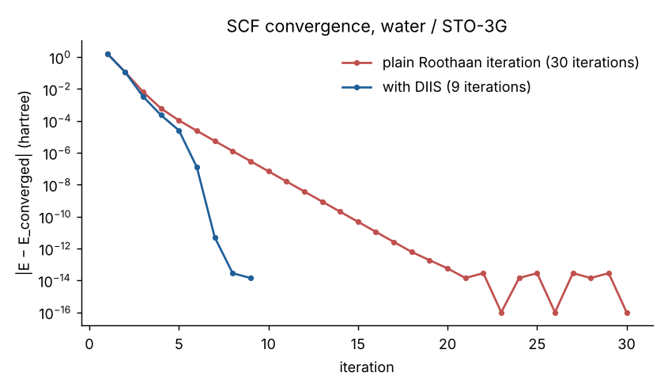

# hartree-fock

Ab initio quantum chemistry from the integrals up, in Python. It computes the Gaussian integrals
with the McMurchie–Davidson scheme, solves the self-consistent field equations (restricted and
unrestricted Hartree–Fock, with DIIS), and adds correlation with MP2 and, for two electrons,
full configuration interaction.

Every integral matches PySCF to about 10⁻¹⁴. Every energy matches PySCF, and for water also the
Crawford group's published reference, to 10⁻¹² hartree or better.



## What's in it

| file | contents |
|---|---|
| [`hf/basis.py`](hf/basis.py) | contracted Cartesian Gaussians, normalisation, the STO-3G basis (H, He, C, N, O) |
| [`hf/integrals.py`](hf/integrals.py) | overlap, kinetic, nuclear attraction, electron repulsion and dipole integrals via Hermite expansion; Boys function |
| [`hf/scf.py`](hf/scf.py) | RHF with DIIS, UHF, MP2, two-electron full CI, dipole moment, Mulliken charges |
| [`hf/molecule.py`](hf/molecule.py) | geometries and nuclear repulsion |

## How the integrals work

The product of two Gaussians on centres A and B is a Gaussian on a third centre P. McMurchie and
Davidson expand that product in Hermite Gaussians Λₜ:

$$G_i(x; a, A)\,G_j(x; b, B) = \sum_t E_t^{ij}\,\Lambda_t(x; p, P),\qquad p = a + b,\ P = \frac{aA + bB}{p}.$$

The E coefficients follow from a three-term recurrence that starts at E₀⁰⁰ = exp(−ab/p·(A−B)²).
Overlap needs only E₀. Kinetic energy is overlap with a differentiated Gaussian. Every Coulomb
integral (nuclear attraction and electron repulsion) reduces to auxiliary integrals R_tuv built
from the Boys function Fₙ(T) = ∫₀¹ t²ⁿ e^(−Tt²) dt. Dipole integrals come free from the same E's.



## Validation

RHF and MP2 total energies (hartree), STO-3G:

| molecule | this code, RHF | reference RHF | this code, MP2 correlation | reference MP2 |
|---|---:|---:|---:|---:|
| H₂ (R = 1.4 bohr) | −1.116714325063 | −1.116714325063 | −0.013157870053 | −0.013157870053 |
| HeH⁺ (R = 1.4632 bohr) | −2.841836499287 | −2.841836499287 | −0.007238266770 | −0.007238266770 |
| H₂O | **−74.942079928192** | −74.942079928192 | **−0.049149636120** | −0.049149636120 |
| NH₃ | −55.454038527135 | −55.454038527135 | −0.047172453998 | −0.047172453998 |
| CH₄ | −39.726743332498 | −39.726743332498 | −0.056459728963 | −0.056459728963 |

The references are PySCF 2.15 with the same basis and geometry; the water geometry is the one from
the Crawford group's programming projects, whose published SCF and MP2 values are the same numbers.
For water this code also gives E_nuc = 8.002367061811, a dipole of 0.603521 a.u. (1.53 D; experiment
1.85 D, a basis-set limitation), and a Mulliken charge of −0.2531 on oxygen. The H₂ full-CI energy at
1.4 bohr, −1.137275943617, matches PySCF's FCI solver.

## What the H₂ curve shows

The plot at the top is the textbook demonstration of why Hartree–Fock is not enough:

- **RHF** puts both electrons in the same spatial orbital, so even at large R it keeps a 50 % ionic
  H⁺H⁻ component. Its energy climbs far above two hydrogen atoms instead of levelling off.
- **UHF** lets the α and β electrons localise on different atoms. Below about 2.2 bohr it falls back
  onto RHF. Beyond that it breaks spin symmetry: at 5 bohr it gives −0.93359 Eₕ, close to
  2 × E(H) = −0.93316 Eₕ, but with ⟨S²⟩ = 0.995 instead of 0, a half-singlet, half-triplet mixture.
- **MP2** improves things near equilibrium but diverges as the HOMO–LUMO gap closes.
- **Full CI** is exact within the basis and dissociates correctly.

Equilibrium bond lengths (minimised with a bounded scalar search):

| method | R_e (bohr) | R_e (Å) | E at R_e (hartree) |
|---|---:|---:|---:|
| RHF | 1.3459 | 0.712 | −1.117506 |
| MP2 | 1.3677 | 0.724 | −1.130137 |
| full CI | 1.3887 | 0.735 | −1.137306 |
| experiment | | 0.741 | |

Correlation lengthens the bond, toward the experimental value. The rest of the gap is STO-3G's
fault.

## Water's orbitals



Valence orbitals of water from this code, plotted in the molecular plane (and, for the
out-of-plane 1b₁ lone pair, the perpendicular plane). The ordering
1a₁ < 2a₁ < 1b₂ < 3a₁ < 1b₁ matches the order of ionisation energies in water's photoelectron
spectrum. The fifth panel is the lowest empty orbital, 4a₁ (the LUMO).

## DIIS

Pulay's DIIS keeps the last six Fock matrices and their commutator errors e = FDS − SDF (which
vanish at self-consistency), and extrapolates to the combination with the smallest error. For
water it converges in 9 iterations instead of 30:



## Tests

16 tests, about 9 s:
- RHF and MP2 energies for all five molecules;
- the published water values;
- dipole and charges;
- idempotency D S D = D, electron count and [F, D] = 0 at convergence;
- DIIS against plain iteration;
- H₂ full CI;
- UHF symmetry breaking and the H atom;
- Boys function identities;
- a closed-form s-overlap;
- basis normalisation;
- every integral matrix against PySCF.

The PySCF comparison is skipped if PySCF isn't installed; CI installs it.

## Run it

```bash
pip install -r requirements.txt pytest pyscf
pytest -q
python -c "from hf import water, rhf, mp2; r = rhf(water()); print(r.energy, mp2(r))"
pip install matplotlib && python scripts/figures.py
```

## Limits

- The integrals are pure Python. Water takes about 1.3 s and methane 3 s, which is fine for STO-3G
  on small molecules but would be far too slow for large basis sets. Real codes use Rys quadrature
  or Obara–Saika recurrences in C, with screening.
- Only STO-3G is built in (s and p functions). The integral code itself handles any angular
  momentum.
- There are no geometry optimisation gradients. The bond lengths above come from scanning the
  energy.

## References

- A. Szabo, N. S. Ostlund, *Modern Quantum Chemistry*, Dover (1996).
- T. Helgaker, P. Jørgensen, J. Olsen, *Molecular Electronic-Structure Theory*, Wiley (2000), ch. 9.
- L. E. McMurchie, E. R. Davidson, *One- and two-electron integrals over Cartesian Gaussian functions*, J. Comput. Phys. 26, 218 (1978).
- P. Pulay, *Convergence acceleration of iterative sequences. The case of SCF iteration*, Chem. Phys. Lett. 73, 393 (1980).
- W. J. Hehre, R. F. Stewart, J. A. Pople, *Self-consistent molecular-orbital methods. I. Use of Gaussian expansions of Slater-type atomic orbitals*, J. Chem. Phys. 51, 2657 (1969).
- T. D. Crawford group, *Programming Projects* (water STO-3G SCF and MP2 reference values).
- Q. Sun et al., *PySCF: the Python-based simulations of chemistry framework*, WIREs Comput. Mol. Sci. 8, e1340 (2018).

## License

Copyright (c) 2026 Ankit Pawar. All Rights Reserved.

This repository is public so that the work can be read and evaluated, but it is not open source. Using, copying, modifying, redistributing or commercially exploiting any part of it requires prior written permission. This does not affect what applicable law allows without permission, or viewing and forking the repository on GitHub under GitHub's Terms of Service. The full terms are in [LICENSE](LICENSE).

Commits up to and including `8089e1c` were released under the MIT License, and copies obtained under those terms keep them.

For licensing or collaboration, email ankitpawar0007x@gmail.com or visit [ankitinorbit.com](https://ankitinorbit.com).
